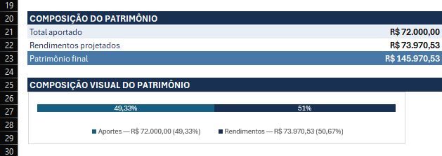
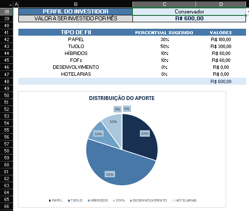
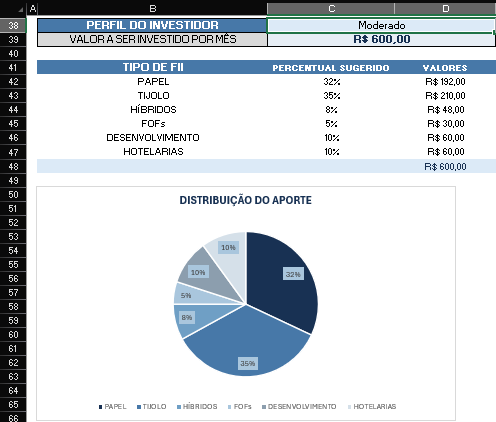
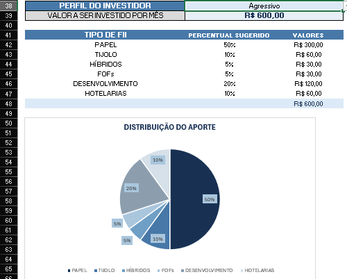

# INVESTA — Simulador de Fundos Imobiliários

**Planeje seus aportes. Projete seu patrimônio.**

A INVESTA é uma ferramenta de simulação financeira desenvolvida no Microsoft Excel, com o objetivo de auxiliar na visualização do crescimento patrimonial por meio de aportes mensais e na distribuição de investimentos entre diferentes categorias de Fundos de Investimento Imobiliário (FIIs).

O projeto foi desenvolvido como parte do desafio prático de Excel da Digital Innovation One (DIO), com base nas aulas ministradas pelo Expert Felipe Aguiar (Felipão).

Além dos recursos apresentados durante as aulas, foram implementadas melhorias na interface, na organização das informações, na visualização dos resultados e na proteção da planilha.

---

## 1. Objetivo do projeto

Desenvolver uma ferramenta interativa, com aparência de aplicativo, capaz de responder a cinco perguntas de negócio:

| Pergunta | Localização na planilha |
|---|---|
| Quanto investir por mês? | Aba SIMULADOR — célula D14 |
| Por quantos anos? | Aba SIMULADOR — célula D15 |
| Qual a taxa de rendimento mensal? | Aba SIMULADOR — célula D16 |
| Quanto de patrimônio será acumulado? | Aba SIMULADOR — célula D17 |
| Quanto serão os dividendos mensais? | Aba SIMULADOR — célula D18 |

A ferramenta permite alterar os parâmetros da simulação e visualizar automaticamente os resultados financeiros.

## 2. Funcionalidades

- Simulação de investimentos com aportes mensais.
- Cálculo do patrimônio acumulado.
- Estimativa de dividendos mensais.
- Projeções financeiras para 2, 5, 10, 20 e 30 anos.
- Configuração de salário e rendimento da carteira.
- Cálculo automático da sugestão de investimento equivalente a 30% do salário.
- Seleção de três perfis de investidor: Conservador, Moderado e Agressivo.
- Distribuição dos aportes entre seis categorias de FIIs.
- Gráfico de pizza dinâmico para visualizar a distribuição dos investimentos.
- Gráfico de barras empilhadas para demonstrar a composição patrimonial.
- Separação entre valores aportados e rendimentos projetados.
- Proteção das células que contêm fórmulas, mantendo os campos de entrada disponíveis para edição.

## 3. Estrutura da planilha

A ferramenta está organizada em duas abas principais:

### SIMULADOR

É a interface principal de utilização da INVESTA.

Apresenta:
- Configurações financeiras;
- Campos de entrada para aporte mensal e prazo;
- Taxa de rendimento mensal;
- Patrimônio acumulado;
- Dividendos mensais estimados;
- Composição patrimonial;
- Projeções para diferentes períodos;
- Seleção do perfil de investidor;
- Distribuição dos aportes e gráficos dinâmicos.

### BASE DE DADOS

Contém a tabela de apoio utilizada na distribuição dos investimentos.

A estrutura apresenta:
- Chave composta;
- Perfil do investidor;
- Tipo de fundo imobiliário;
- Percentual sugerido para cada categoria.

Essa organização permite que o simulador busque automaticamente os percentuais correspondentes ao perfil selecionado.

## 4. Fórmulas e recursos utilizados

### 4.1. Função VF — Valor Futuro

A função VF é utilizada para calcular o patrimônio acumulado considerando os aportes mensais, a taxa de rendimento e o período de investimento.

Fórmula utilizada:

`=VF(taxa_mensal;qts_anos*12;aporte*-1)`

Argumentos:

- `taxa_mensal`: taxa de rendimento mensal;
- `qts_anos*12`: quantidade de períodos mensais;
- `aporte*-1`: valor do aporte mensal, informado como saída de caixa.

A função também é utilizada nas projeções de patrimônio para diferentes horizontes de investimento.

### 4.2. Cálculo dos dividendos

O valor estimado dos dividendos mensais é calculado a partir do patrimônio acumulado e do rendimento mensal da carteira.

### 4.3. Função PROCV e chave composta

A função PROCV é utilizada para localizar os percentuais de distribuição dos investimentos de acordo com o perfil selecionado.

Foi criada uma chave composta pela combinação do perfil do investidor e do tipo de fundo imobiliário.

Exemplos:

- Conservador-PAPEL
- Moderado-TIJOLO
- Agressivo-HÍBRIDOS

Essa chave permite localizar o percentual correspondente na aba BASE DE DADOS por meio de uma busca com correspondência exata.

Quando o usuário altera o perfil, os percentuais e os valores destinados a cada categoria são atualizados automaticamente.

### 4.4. Intervalos nomeados

Foram criados sete intervalos nomeados:

| Nome | Referência |
|---|---|
| aporte | SIMULADOR!$D$14 |
| patrimonio | SIMULADOR!$D$17 |
| qts_anos | SIMULADOR!$D$15 |
| rendimento_carteira | SIMULADOR!$D$10 |
| salario | SIMULADOR!$D$9 |
| sugestao_investimento | SIMULADOR!$D$11 |
| taxa_mensal | SIMULADOR!$D$16 |

## 5. Perfis de investimento

Os percentuais foram baseados nos exemplos apresentados pelo Expert Felipe Aguiar durante as aulas da DIO.

| Categoria | Conservador | Moderado | Agressivo |
|---|---:|---:|---:|
| Papel | 30% | 32% | 50% |
| Tijolo | 50% | 35% | 10% |
| Híbridos | 10% | 8% | 5% |
| FOFs | 10% | 5% | 5% |
| Desenvolvimento | 0% | 10% | 20% |
| Hotelarias | 0% | 10% | 10% |
| **Total** | **100%** | **100%** | **100%** |

Os percentuais são parâmetros ilustrativos e não representam recomendações de investimento.

## 6. Simulação demonstrativa

Parâmetros utilizados:

| Parâmetro | Valor |
|---|---:|
| Salário demonstrativo | R$ 4.000,00 |
| Rendimento da carteira | 0,60% ao mês |
| Sugestão de investimento | R$ 1.200,00 |
| Aporte mensal | R$ 600,00 |
| Prazo | 10 anos |
| Taxa mensal de acumulação | 1,079% |

Resultados:

| Indicador | Resultado |
|---|---:|
| Total aportado | R$ 72.000,00 |
| Rendimentos projetados | R$ 73.970,53 |
| Patrimônio final | R$ 145.970,53 |
| Dividendos mensais estimados | R$ 875,82 |

Os valores são fictícios e utilizados apenas para demonstrar o funcionamento da ferramenta. As projeções não garantem rentabilidade futura.

## 7. Demonstração visual

### 7.1. Composição patrimonial

### 7.2. Perfil Conservador

### 7.3. Perfil Moderado

### 7.4. Perfil Agressivo

## 8. Melhorias implementadas

Além dos recursos apresentados nas aulas, foram desenvolvidas as seguintes melhorias:

- Criação de identidade visual própria para a INVESTA.
- Personalização da interface com tons de azul.
- Organização dos indicadores financeiros em seções.
- Criação da seção de composição patrimonial.
- Separação entre total aportado, rendimentos projetados e patrimônio final.
- Inclusão de gráfico de barras empilhadas para visualizar a composição patrimonial.
- Personalização do gráfico de distribuição dos aportes.
- Proteção das células calculadas.
- Liberação dos campos destinados à entrada de informações.
- Testes com os três perfis de investidor.
- Validação das distribuições para garantir o total de 100% em cada perfil.

## 9. Tecnologias e recursos utilizados

- Microsoft Excel;
- Função VF;
- Função PROCV;
- Intervalos nomeados;
- Chave composta;
- Validação de dados;
- Referências relativas e absolutas;
- Gráficos dinâmicos;
- Formatação condicional;
- Proteção de planilhas;
- GitHub para versionamento e documentação.

## 10. Aprendizados

O desenvolvimento da INVESTA proporcionou a aplicação prática de conhecimentos de Excel na construção de uma ferramenta voltada a um problema de negócio.

Durante o projeto, foram praticados:

- Organização e estruturação de bases de dados;
- Construção e manutenção de fórmulas;
- Utilização de referências relativas e absolutas;
- Criação de intervalos nomeados;
- Aplicação de buscas com chave composta;
- Construção de indicadores financeiros;
- Desenvolvimento de gráficos para visualização de dados;
- Testes, identificação e correção de erros;
- Proteção de fórmulas;
- Documentação e publicação de projetos no GitHub.

## 11. Arquivo do projeto

A planilha oficial está disponível neste repositório:

[Baixar INVESTAOFICIAL.xlsx](INVESTAOFICIAL.xlsx)

---

**Desenvolvido por:** Gabriela

**Instituição:** Digital Innovation One (DIO)

**Desafio:** Simulador de Investimentos em Fundos Imobiliários com Excel.

**Projeto:** INVESTA — Simulador de Fundos Imobiliários.

*Planeje seus aportes. Projete seu patrimônio.*
